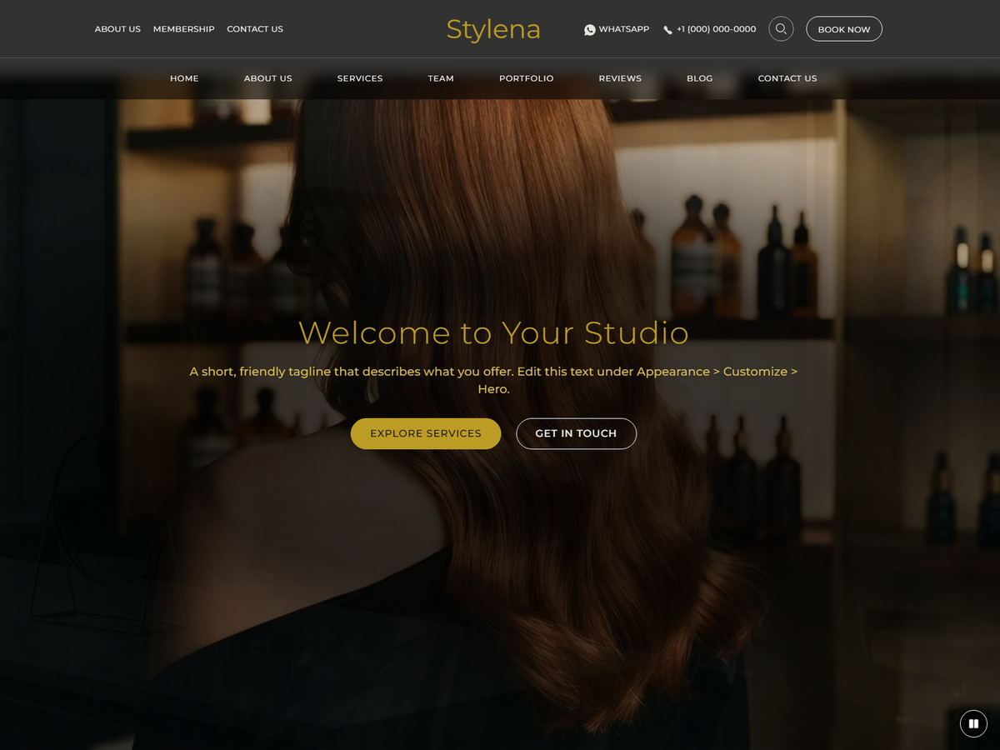

# Stylena

A classic WordPress theme for beauty and wellness businesses: salons, spas and clinics. Full-width homepage hero with an optional background video, a two-row navigation, and sections for services, team, portfolio, FAQ, reviews and an image slider, all editable in the Customizer.

**Version 1.3.0** | WordPress 6.8+ | PHP 8.1+ | License: GPLv2 or later (see [Licence and credits](#licence-and-credits))

## Requirements

- WordPress 6.8 or higher (tested up to 6.8)
- PHP 8.1 or higher
- MySQL 5.6 or higher (8.0+ recommended); HTTPS recommended

## Installation

1. Appearance > Themes > Add New > Upload Theme, choose the theme zip, then Activate. (Or upload the `stylena` folder to `/wp-content/themes/` by FTP.)
2. Appearance > Install Plugins: install and activate **Stylena Core** (required, bundled).
3. Optional: install One Click Demo Import, Contact Form 7 and Yoast SEO from the same screen.

Activation creates no content. Details: [docs/installation.md](docs/installation.md).

## Quick start

1. Import the sample site on a fresh install (Appearance > Import Demo Data), or start empty.
2. Appearance > Menus: create menus for the Primary, Top Left and Top Right locations.
3. Settings > Reading: set a static front page (the demo import does this for you).
4. Appearance > Customize > Site Identity: upload your logo.
5. Appearance > Customize > Stylena Theme Options: set fonts, colours, hero text, hero video and the homepage sections.

## Features

- Full-width hero with optional background video and poster image (Customizer > Hero Section)
- Two-row navigation with centred logo, mobile hamburger menu, custom logo, light/dark/mobile logo variants
- Customizer panel: Typography, Colors, Hero, About, Services, Team, Image Slider, Advice, Reviews, FAQ, Homepage Sections, Header, Footer, Portfolio
- Page templates: Services, Portfolio, Teams, About Us, Contact Us, Reviews, Membership, Full Width
- Services, Team, Portfolio, FAQ and Image Slider content types (plus `[stylena_slider]` and widgets) provided by the bundled **Stylena Core** plugin, so content survives a theme switch
- Google Reviews with a manual fallback (opt-in)
- Portfolio grid with category filters, Load More and an accessible lightbox
- AJAX live search (desktop and mobile)
- Self-hosted fonts: Montserrat (default), Exo, Aboreto
- Eight widget areas, post formats, editor styles, wide alignment, responsive embeds
- Translation-ready (text domain `stylena`, `languages/stylena.pot`) with an RTL stylesheet
- Optional basic WooCommerce and booking-plugin styling (loads only when the plugin is active)
- Developer hooks and child-theme overrides: [docs/hooks.md](docs/hooks.md)

## Recommended plugins

| Plugin | Status |
| --- | --- |
| Stylena Core | Required (bundled): content types, taxonomy, shortcode, widgets |
| One Click Demo Import | Optional: demo import |
| Contact Form 7 | Optional: contact and booking forms |
| Yoast SEO | Optional: search engine optimisation |

See [docs/recommended-plugins.md](docs/recommended-plugins.md).

## Demo import

Appearance > Import Demo Data (needs One Click Demo Import and Stylena Core). It adds sample pages, menus, services, team members, FAQs, portfolio items and slides, only on request. Sample images and the hero video are downloaded from the demo server and are not in the theme download; if the server is unreachable the theme keeps neutral placeholders. The import only touches content it created. See [docs/demo-import.md](docs/demo-import.md).

## External services

Stylena makes no third-party requests by default (fonts are self-hosted, no analytics or tracking). Every contact below is optional and started by an administrator:

- **Demo media host** (Appearance > Import Demo Data): downloads about 30 AI-generated images and one short video from `stylena.zylonex.com` into your Media Library. Your server's IP address is visible to that host. Not used on normal page views.
- **Google Fonts** (Customizer > Typography, off by default): loads non-bundled font families from Google when enabled; visitors' IP addresses are sent to Google. [Privacy policy](https://policies.google.com/privacy)
- **Google Places API** (Customizer > Reviews Section, opt-in, off by default): after you tick the opt-in and enter your own API key and Place ID, your server requests your reviews from `maps.googleapis.com` (cached about 12 hours). [Terms](https://cloud.google.com/maps-platform/terms), [privacy](https://policies.google.com/privacy)

The same text is in `readme.txt` (External Services).

## AI-generated demo media

Sample photographs, the hero video and the theme screenshot are AI-generated (Google Gemini) and are not part of the theme download except screenshot.png (preview only). This covers the hero poster, portraits, services, slider, portfolio, blog, membership card, map and similar images, all generated with the Google Gemini image generation API, not photographed. See `docs/ai-disclosure.md`. The people shown are synthetic and do not depict real individuals. The hero video is a looping zoom animation made from the AI hero poster (no third-party video or audio). These files are not in the theme download; the demo import downloads them. Replace them with your own before launching a real site. Provenance is in `demo/README.txt`.

## Licence and credits

Stylena is licensed under GPL v2 or later (`license.txt`). Copyright Zylonex (https://zylonex.com). The code is GPL-2.0-or-later; the AI-generated demo media is separate (see above and `docs/ai-disclosure.md`) and is not part of the download except `screenshot.png` (preview only). Bundled third-party components keep their own licences:

| Component | Licence | Location |
| --- | --- | --- |
| Bootstrap 4.6.2 | MIT | `assets/` (`assets/bootstrap-license.txt`) |
| Font Awesome Free 5.15.4 | Icons CC BY 4.0, fonts SIL OFL 1.1, code MIT | `assets/fontawesome/` |
| Exo | SIL OFL 1.1 | `fonts/exo/OFL.txt` |
| Montserrat | SIL OFL 1.1 | `fonts/montserrat/OFL.txt` |
| Aboreto | SIL OFL 1.1 | `fonts/aboreto/OFL.txt` |
| TGM Plugin Activation 2.6.1 | GPL-2.0-or-later | `inc/vendor/` (`LICENSE-TGMPA.md`) |

## Documentation

- [docs/README.md](docs/README.md): index
- [Installation](docs/installation.md), [Demo import](docs/demo-import.md), [Customizer guide](docs/customizer.md), [Content types](docs/content-types.md), [Hero video](docs/hero-video.md)
- [Troubleshooting](docs/troubleshooting.md), [FAQ](docs/faq.md), [Hooks (developers)](docs/hooks.md)
- [changelog.txt](changelog.txt), [readme.txt](readme.txt)

## Support

Email support@zylonex.com (TO CONFIRM). Please include your Stylena, WordPress and PHP versions, active plugins, exact error text and steps to reproduce. Policies: [support](docs/support-policy.md), [refunds](docs/refund-policy.md). Product page: https://stylena.zylonex.com.
